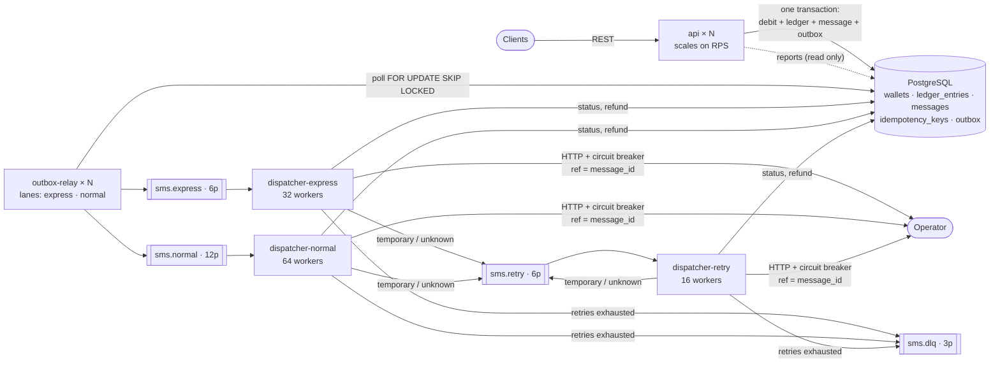
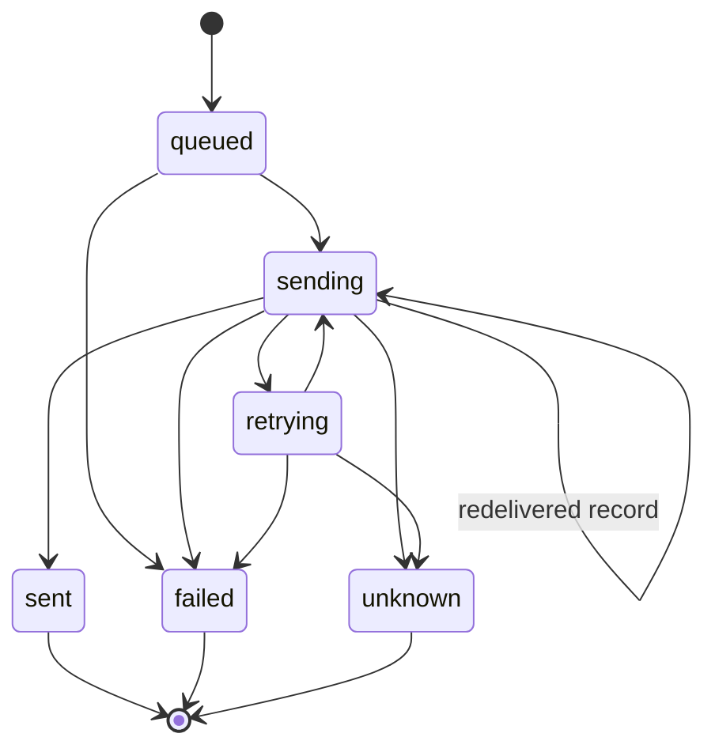

# SMS Gateway: Architecture

This document describes the system as built, why it is built that way, how it
fails, and what a production deployment would add. Each significant decision has
an ADR in [`docs/adr/`](adr/); this document links to them rather than repeating
them.

**Contents**
1. [Problem and requirements](#1-problem-and-requirements)
2. [Capacity estimation](#2-capacity-estimation)
3. [Components](#3-components)
4. [Life of one message](#4-life-of-one-message)
5. [Data model and partitioning](#5-data-model-and-partitioning)
6. [Key decisions](#6-key-decisions)
7. [Failure modes](#7-failure-modes)
8. [Fairness and express guarantees](#8-fairness-and-express-guarantees)
9. [Production path (not built)](#9-production-path-not-built)
10. [Load test results](#10-load-test-results)
11. [Known limitations](#11-known-limitations)

---

## 1. Problem and requirements

A prepaid SMS gateway for businesses, exposed as a REST API.

**Functional requirements (from the challenge)**
- Customers send SMS to any number and fetch reports of the messages they sent.
- Each customer has a prepaid balance and must top up before sending.
- The balance must **never** go negative, and a customer may spend all of it.
- **Express** messages have a guaranteed maximum latency until they are handed
  to the operator.

**Non-functional requirements**
- Tens of thousands of businesses, about **100M SMS/day**.
- Very uneven load: a few customers send at huge rates, most send rarely.

**Assumptions** (decided by us, stated so they can be challenged)

| Assumption | Consequence in the design |
|---|---|
| No authentication or user management. `customer_id` is passed in the request. | No auth middleware. The path or body `customer_id` is trusted. |
| Single-page messages only. | The body must fit one SMS: 160 GSM/Latin characters, or 70 for other scripts such as Persian. Longer bodies get 400. |
| Persian and English cost the same. | One price per message (`SMS_PRICE`, integer minor units). |
| **`sent` means handed to the operator, not delivered to the handset.** | There are no delivery reports (DLR) yet. That is on the production path. |
| **Express SLA (our definition):** p99 from acceptance to handed-to-operator **under 5 s**, and a **hard TTL of 2 minutes**. | After the TTL an express message is not sent. It becomes `failed` and is refunded, or `unknown` if an earlier attempt might have delivered it. |
| "Never negative" is a hard invariant, enforced by the database. | Conditional UPDATE plus a `CHECK (balance >= 0)` constraint. |

---

## 2. Capacity estimation

### Throughput
| Quantity | Value | Derivation |
|---|---:|---|
| Average rate | **~1,160 msg/s** | 100,000,000 / 86,400 |
| Peak rate (assumed 5×) | **~6,000 msg/s** | Business traffic is concentrated in daytime and campaigns |
| Postgres row writes per message | ~9 | idempotency key, wallet, ledger, message, outbox insert, outbox `published_at`, outbox delete, status `sending`, status `sent` |
| Postgres commits per message | ~3 | 1 accept transaction, 2 status transactions. The relay is batched (500 rows per commit). |
| Peak Postgres load | **~50k row writes/s, ~18k commits/s** | 6,000 × 9 and 6,000 × 3 |

One well-provisioned Postgres primary (NVMe, group commit) can handle this, but
**it is the system's ceiling**. Every other tier scales horizontally. Section 9
covers what comes after that.

### Storage per day
Row sizes include the tuple header and an average body of 100 bytes (Persian
text is 2 bytes per character in UTF-8).

| Data | Per message | Per day | Retention |
|---|---:|---:|---|
| `messages` (row ~300 B + 2 indexes ~75 B) | ~375 B | **~37 GB** | Daily partitions; drop or detach old days (e.g. 90 days, about 3.4 TB) |
| `ledger_entries` (row ~90 B + 2 indexes ~50 B) | ~140 B | ~14 GB | Monthly partitions; kept long-term (money) |
| `idempotency_keys` (only if the client sends a key) | ~250 B | up to ~25 GB | Should be about 24 h. Cleanup isn't built yet (§11). |
| `outbox` (deleted 1 h after publishing) | ~500 B | ~2 GB **steady state** | 1 h |
| Kafka, per replica (value ~400 B, uncompressed) | ~470 B | ~47 GB | 7 days at RF=3 is about 1 TB across the cluster |

### Per-customer ceiling (hot wallet)
Every debit for one customer locks that customer's single `wallets` row until
the accept transaction commits, which takes about 1–3 ms. A single customer
therefore tops out at roughly **300–1,000 messages/s**, however many API
instances run. **Measured: ~400 msg/s** for one customer on the test machine
(§10), with Postgres mostly idle. It is a lock ceiling, not a CPU ceiling. A rate-limit plan above that ceiling doesn't help on its own:
such customers also need the sub-wallet mitigation in §9.

---

## 3. Components

One Go codebase (a *modular monolith*), one Postgres, and four binaries that are
deployed and scaled independently ([ADR 0001](adr/0001-modular-monolith.md)).



| Binary | Responsibility | Scales on |
|---|---|---|
| `api` | Top-up, balance, accept messages, reports, health | Request rate (stateless) |
| `outbox-relay` | Publish outbox rows to Kafka, one loop per lane; clean up | Outbox lag (age of oldest unpublished row) |
| `dispatcher` | Consume express/normal/retry, call the operator, update status, refund | Consumer lag, up to the partition count |
| `operator-mock` | Fake operator for local runs and tests | — |

**Code layout.** Folders are per module, not per layer: `wallet`, `sms`,
`dispatch`, `report`, `ratelimit`, `outbox`, `operator`, plus `platform` for
shared setup. Each module owns its tables, and other modules call its exported
functions. Dependencies go one way: `sms → wallet, outbox`;
`dispatch → sms, operator`; `report` only reads.

The one controlled exception is that `sms` passes its transaction to
`wallet.Debit` and `outbox.Insert`, so money and message commit atomically
([ADR 0001](adr/0001-modular-monolith.md)).

---

## 4. Life of one message

```mermaid
sequenceDiagram
    autonumber
    participant C as Client
    participant A as api
    participant P as PostgreSQL
    participant R as outbox-relay
    participant K as Kafka
    participant D as dispatcher
    participant O as Operator

    C->>A: POST /messages (+ Idempotency-Key)
    A->>A: validate, rate limit (token bucket per customer and class)
    A->>P: BEGIN, claim idempotency key, debit wallet + ledger row,<br/>insert message (queued), insert outbox row, COMMIT
    A-->>C: 202 {message_id, status: queued}

    R->>P: SELECT ... WHERE topic = lane FOR UPDATE SKIP LOCKED LIMIT 500
    R->>K: ProduceSync (key = message_id, acks=all, idempotent)
    R->>P: UPDATE outbox SET published_at = now(), COMMIT

    K->>D: poll batch (dispatcher-express or dispatcher-normal)
    D->>P: status → sending (guarded; 0 rows = already terminal, skip)
    opt express and past expires_at
        D->>P: status → failed + refund (or unknown if uncertain), stop
    end
    D->>O: POST /send {ref: message_id, to, text}
    alt 2xx
        O-->>D: {operator_msg_id}
        D->>P: status → sent, handed_at = now(), operator_msg_id
    else 4xx (permanent)
        D->>P: status → failed + wallet refund (one transaction)
    else 5xx / 429 / timeout (temporary or unknown)
        D->>K: produce sms.retry (attempt + 1, next_attempt_at)
        D->>P: status → retrying
    end
    D->>K: commit offsets (after the whole batch)
```

Retries come back through `dispatcher-retry`, which waits until
`next_attempt_at` (1 s, 2 s, 4 s, 8 s ... capped at 30 s). After 5 attempts the
event goes to `sms.dlq`. The message ends `failed` and refunded, or `unknown`
and not refunded if any attempt timed out after the request was sent
([ADR 0005](adr/0005-dispatcher.md)).

---

## 5. Data model and partitioning

| Table | Owner | Key | Other indexes | Partitioning |
|---|---|---|---|---|
| `wallets` | wallet | `customer_id` | — | none (one row per customer) |
| `ledger_entries` | wallet | `(id, created_at)` | `(customer_id, created_at DESC)` | **monthly** by `created_at`, plus DEFAULT |
| `messages` | sms | `(id, created_at)` | `(customer_id, created_at DESC)` | **daily** by `created_at`, plus DEFAULT |
| `idempotency_keys` | sms | `(customer_id, key)` | — | none |
| `customer_limits` | ratelimit | `customer_id` | — | none (rate-limit plans; read into memory every 10 s) |
| `outbox` | outbox | `id` (bigserial) | `(topic, id) WHERE published_at IS NULL` | none (rows live about 1 h) |

**Money.** All amounts are integers in minor units, never floats.
- `wallets.balance` has `CHECK (balance >= 0)` and is the fast-path cache.
- `ledger_entries` is the source of truth: each row is signed (top-up and refund
  are positive, debit is negative), so `SUM(amount) = balance` per customer.
- The debit is a single `UPDATE wallets SET balance = balance - $cost WHERE customer_id = $1 AND balance >= $cost`.
  If no row changes, the API returns 402 ([ADR 0003](adr/0003-money-and-idempotency.md)).

**Why partition.** Daily `messages` partitions mean:
- a report query only reads the days in its range;
- old days are dropped with `DROP TABLE` instead of a massive `DELETE`;
- each partition's indexes stay small.

Every query on `messages` includes `created_at`:
- reports require a `from`/`to` range of at most 31 days;
- the dispatcher carries `created_at` in the Kafka event;
- get-by-id derives it from the UUIDv7 timestamp.

So Postgres never probes every partition. In the test, get-by-id reads 1 of 9
partitions ([ADR 0006](adr/0006-reports.md)).

**Message ids** are UUIDv7: time-ordered, so inserts append to the B-tree, and
the time can be recovered from the id.

**Status machine** (every transition is an `UPDATE ... WHERE status = ANY(<allowed sources>)`):



| Terminal status | Meaning | Refunded |
|---|---|---|
| `sent` | Handed to the operator | No |
| `failed` | Certainly not delivered: rejected (4xx), retries exhausted, or express expired | **Yes, exactly once** |
| `unknown` | Maybe delivered: an attempt timed out after the request was sent, and nothing settled it | **No**: needs reconciliation with the operator |

---

## 6. Key decisions

| # | Decision | ADR |
|---|---|---|
| 1 | Modular monolith with four independently scaled binaries; debit + message + outbox in one transaction | [0001](adr/0001-modular-monolith.md) |
| 2 | Kafka as the backbone, fed by a transactional outbox; partition key = `message_id`; explicit topics | [0002](adr/0002-kafka.md) |
| 3 | Integer money, signed ledger + cached balance, conditional-UPDATE debit, idempotency keys with request hash, allow-list status transitions, refund guarded by the status transition, UUIDv7, daily partitions | [0003](adr/0003-money-and-idempotency.md) |
| 4 | Outbox relay with one independent lane per topic, `FOR UPDATE SKIP LOCKED`, per-lane index, cleanup and lag | [0004](adr/0004-outbox-relay.md) |
| 5 | Dispatcher lanes, batch commit, operator errors classified Permanent/Temporary/Unknown, sticky uncertainty, circuit breaker with back-pressure, produce-before-update | [0005](adr/0005-dispatcher.md) |
| 6 | Reports with keyset pagination, a required 31-day range, an opaque filter-bound cursor, UUIDv7 get-by-id, and the index trade-off | [0006](adr/0006-reports.md) |
| 7 | Per-customer token bucket per class from the customer's plan (cached), before the transaction; per-instance = global / replicas; Redis as the production path | [0007](adr/0007-rate-limiting.md) |

---

## 7. Failure modes

Kafka delivery is at-least-once everywhere. Safety comes from three mechanisms:
1. one Postgres transaction for every money change;
2. status transitions guarded by an allow-list;
3. the operator deduplicating by `ref = message_id`.

| Failure | What happens | Why it is safe |
|---|---|---|
| **API crashes mid-request** | If the transaction didn't commit, nothing exists. If it committed but the response was lost, the client retries. | With an `Idempotency-Key`, the retry gets the original response and is not charged again. **Without a key the retry is a new message and a second charge.** That is documented for clients (README). |
| **outbox-relay crashes** | The open transaction rolls back and its row locks are released. Those rows are published again, possibly twice if Kafka already had them. | Duplicate records are absorbed by the dispatcher (see "duplicate delivery"). No committed message is ever lost. |
| **dispatcher crashes** | Offsets for the current batch aren't committed, so the batch is redelivered. | A `sent`/`failed`/`unknown` message is skipped (0 rows). A message stuck in `sending` is sent again with the same ref, and the operator dedupes. A refund is in the same transaction as `→ failed`, so it can't happen twice. |
| **Kafka down** | The API keeps accepting, because messages go to the Postgres outbox. The relay backs off (100 ms to 5 s). The dispatcher has nothing to fetch, or retries its retry/DLQ produce in place. | The outbox holds everything. Delivery resumes when Kafka returns. Express messages older than 2 min are then refunded instead of sent late. The API never connects to Kafka and its `/readyz` checks only Postgres, so it stays in the load balancer. The outage shows up as outbox lag. |
| **Postgres down** | The API returns 500 and `/readyz` returns 503. The relay and dispatcher retry their statements with backoff and don't commit offsets. | Nothing is accepted without the database, so no money moves without a record. In-flight dispatches finish when it returns. |
| **Operator slow** (above the 5 s timeout) | The send times out after the request was written: **Unknown**. It is retried with the same ref. Timeouts count toward the circuit breaker. | No refund for Unknown. A later 2xx (dedupe returns the original id) or a 4xx settles it. If nothing settles it, the message ends `unknown`, not refunded. |
| **Operator down** | 5 consecutive failures open the breaker (30 s, then 1 trial request). Workers hold their messages and retry every second. The batch can't finish, so the lane stops fetching. | No attempts are wasted, `sms.retry` isn't flooded, and nothing is refunded. In the end-to-end test, 10 messages sent during an outage were all `sent` within seconds of recovery, with 1 retry event. |
| **Operator rejects (4xx)** | Permanent: `failed` and refunded in one transaction. | Definitely not delivered: a delivered ref would have been answered with its original id. |
| **Duplicate Kafka delivery** | From a relay crash, a rebalance, or a retry event arriving after success. | `→ sending` from a terminal state matches 0 rows, so it is skipped. Late "fail" events can't move `sent`. Tested. |
| **Two dispatchers handle the same record at once** | Both may enter `sending` (re-entry is allowed) and both call the operator. | The operator dedupes by ref: 1 real send. Tested with the real client and mock. |
| **Express message waits too long** (backlog, outage) | It is checked against `expires_at` before every send attempt. | Not sent late: `failed` + refund, or `unknown` if uncertain. |
| **One customer sends above its wallet ceiling (within its plan)** | Its requests queue on its wallet-row lock, and each waiting request holds an API database connection. | **Not fully safe today.** When the pool is exhausted, other customers' requests wait for a connection too. In the load test, express accept latency rose to seconds (§10). Plans should stay below the ceiling; the fix is in §11. |
| **One customer floods the API** | Token bucket per customer and class; 429 with `Retry-After`, checked before any database work. | Other customers' capacity and that customer's express allowance are untouched. |

---

## 8. Fairness and express guarantees

**Fairness between customers**
- **Rate limit per customer and class, from the customer's plan.**
  - Heavy senders get their own plan (`PUT /customers/{id}/limits`, stored in
    `customer_limits`). Everyone else gets the defaults: normal 200 msg/s
    (burst 400) and express 50 msg/s (burst 100).
  - Plans are cached in memory and refreshed every 10 s, and the limit is
    checked before the database. A flood therefore costs one map lookup per
    request and no query ([ADR 0007](adr/0007-rate-limiting.md)).
  - Limits are exact per instance and approximate across instances
    (global / `API_INSTANCES`). Exact global limits need the Redis limiter in §9.
- **Partition key = `message_id`.** A heavy customer's traffic spreads over every
  partition and every worker instead of saturating one
  ([ADR 0002](adr/0002-kafka.md)).
- **Bounded worker pools** per lane. A backlog becomes consumer lag, not unbounded
  memory or goroutines.

**Express isolation.** Express shares nothing with normal traffic on its way to
the operator:

| Stage | Express | Normal |
|---|---|---|
| Outbox relay | own loop, own Kafka producer, 20 ms idle poll, no linger | own loop, 100 ms idle poll |
| Outbox index | `(topic, id)` section `sms.express` | section `sms.normal` |
| Topic | `sms.express` (6 partitions) | `sms.normal` (12) |
| Consumer group | `dispatcher-express`, 32 workers | `dispatcher-normal`, 64 workers |

The only shared resources are Postgres and the operator itself. Its circuit
breaker is shared on purpose: when the operator is down, it is down for both.

**Express SLA.**
- **Target:** p99 from acceptance to handed-to-operator under 5 s.
- **Hard limit:** 2 min (`EXPRESS_TTL`), checked before every send.
- **Measurement:** `handed_at - created_at`, both from the Postgres clock.
  The dispatcher logs it per message (`latency_ms`), and the load test (§10)
  computes percentiles from the `messages` table.
- **Observed:** in the local end-to-end run, express averaged about 97 ms
  (operator mock latency 50 ms).

---

## 9. Production path (not built)

| Area | What production adds | Why |
|---|---|---|
| Orchestration | Kubernetes Deployments per binary. HPA on CPU/RPS for `api`, and on **Kafka consumer lag** (KEDA) for `dispatcher` and outbox lag for `outbox-relay` | Each tier scales on its own signal |
| Kafka | 3+ brokers, RF=3, `min.insync.replicas=2`, rack-aware; more partitions for headroom | Survive a broker loss with no data loss (we already use acks=all) |
| Rate limiter | Redis token bucket / GCRA in one Lua call, falling back to the local limiter if Redis is down | Exact global limits regardless of replica count ([ADR 0007](adr/0007-rate-limiting.md)) |
| Partitions | `pg_partman` (or a daily job) creates partitions ahead and drops expired days | Rows must never fall into DEFAULT (§11) |
| Reports and analytics | Produce `sms.status` events and stream them into **ClickHouse** for aggregates and long history | Keep analytics off the OLTP primary ([ADR 0006](adr/0006-reports.md)) |
| Reads | Report queries on a read replica | Offload the primary |
| Money integrity | **Nightly reconciliation**: `SUM(ledger)` against `balance` per customer; old ledger rows rolled into monthly aggregates | Detect drift early; keep the ledger queryable |
| `unknown` messages | Reconciliation job against operator records (by `ref`), then `sent` or `failed` + refund | Resolve uncertainty without manual work |
| Hot wallets | For customers above about 500 msg/s: split the balance across N sub-wallets (debit a random one), or reserve credit in batches | Removes the single-row-lock ceiling (§2) |
| Delivery reports (DLR) | Operator callback endpoint, `delivered` / `undelivered` statuses, published on `sms.status` | `sent` today only means handed over |
| Observability | Prometheus metrics: express/normal latency histograms, outbox lag, consumer lag, breaker state; OpenTelemetry traces across api, Kafka and dispatcher | The SLA must be measured continuously, not from logs |
| Idempotency keys | TTL cleanup (e.g. 24 h) in chunks, or daily partitions on `idempotency_keys` | Bounded table (§2) |
| Beyond one Postgres primary | Shard by `customer_id` (Citus, or application-level shards). Every money transaction is single-customer, so it shards cleanly | The ceiling in §2 |
| Operator | Several operators with routing and per-operator breakers | Redundancy and cost |

---

## 10. Load test results

Measured with k6 ([`loadtest/k6.js`](../loadtest/k6.js)). Delivery latency is
computed in Postgres from `handed_at - created_at`
([`loadtest/latency.sql`](../loadtest/latency.sql)), **after the backlog has
drained**, so it covers every message, not only the fast ones. Reproduce with
`make loadtest` or `loadtest/run.sh capacity|fairness`.

### Setup
| Item | Value |
|---|---|
| Machine | One laptop, WSL2: 16 vCPU, 7.5 GB RAM. **Everything runs on it**: Postgres, Kafka, all binaries and k6. |
| Versions | Go 1.22, PostgreSQL 16.4 (`synchronous_commit=on`, defaults otherwise), Kafka 3.8 (1 broker, RF=1), k6 0.54 |
| Replicas | 1 of each: `api` (DB pool 16 connections), `outbox-relay`, `dispatcher` (express 32 / normal 64 / retry 16 workers) |
| Operator | `operator-mock`, 50 ms latency, no failures |
| Logging | `LOG_LEVEL=warn` for every service (per-message info logs would distort the numbers) |
| Load | `constant-arrival-rate`. Every request has a unique `Idempotency-Key`, the way clients are advised to call the API. |

### Run 1, capacity: 10 heavy customers at 800 msg/s total, plus 100 express customers at 100 msg/s total, for 2 min
Heavy customers are on a 5,000 msg/s plan, so the limiter doesn't interfere.

| | Normal | Express |
|---|---:|---:|
| Accepted (202) | 96,001 (800/s) | 12,001 (100/s) |
| Rejected / errors | 0 | 0 |
| `POST /messages` latency p50 / p95 / p99 | 3.4 / 5.6 / 8.2 ms | 3.5 / 5.7 / 8.2 ms |
| Handed to the operator | 798/s, all `sent` | 100/s, all `sent` |
| **Accept → handed, p50 / p95 / p99** | 415 / 531 / 575 ms | **172 / 205 / 215 ms** |

Express p99 is **215 ms against the 5 s target**.

**This run did not saturate the system.** The 900 msg/s end to end (800 normal +
100 express) is a **lower bound** for this 16 vCPU laptop, not its maximum: the
backlog drained **0 s** after k6 stopped, so every tier kept up the whole time.
The busiest component was **Postgres at ~2 cores** (1.7 mid-run), followed by
api 0.9, dispatcher 0.8 and relay 0.06, which leaves most of the 16 vCPUs idle.
The ceilings in the next table come from separate overload runs.

### Run 2, fairness: one heavy customer sends 1,000 msg/s on the default plan (200 msg/s), plus 100 express customers at 100 msg/s total, for 2 min
| | Heavy customer (normal) | Express customers |
|---|---:|---:|
| Accepted (202) | 24,397 (**203/s**, its plan) | 11,994 (100/s, all of them) |
| Rate-limited (429) | 95,510 | 0 |
| `POST /messages` p50 / p95 / p99 | 0.3 / 4.1 / 10.4 ms (429s are cheap) | 3.1 / 6.5 / 199 ms |
| **Accept → handed, p50 / p95 / p99** | 115 / 163 / 188 ms | **158 / 189 / 199 ms** |

The heavy customer is held to its plan at a negligible cost (a 429 never
touches Postgres). The express customers get exactly what they sent, with
delivery latency equal to Run 1.

### Finding the ceilings (30 s calibration runs)
| Load | Result | Ceiling found |
|---|---|---|
| 1 heavy customer, offered 500 / 1,000 / 2,000 msg/s | Accepted **~400/s** every time. Postgres at ~1.5 of 16 cores. | **Single-wallet ceiling ≈ 400 msg/s** (row lock, §2) |
| 10 heavy customers, offered 1,500 msg/s | API accepted 1,500/s (p99 23 ms). Dispatcher handed 921/s, so a backlog built up: normal p50 8.6 s, **express p99 still 233 ms**. | **Dispatcher normal lane ≈ 900 msg/s per replica** |
| 10 heavy customers, offered 3,000 msg/s | API accepted **2,070/s** (p99 1.8 s, saturated). Postgres ~4.1 cores, api ~2.3 cores. | **API ≈ 2,000 msg/s per replica** on this machine |

Two observations from the calibration:
- **Express isolation holds under overload.** With a 20–50 s normal backlog,
  express delivery p99 stayed at 233–307 ms, because it has its own topic,
  consumer group and workers.
- **Hot wallet affects other customers.** With one customer above its wallet
  ceiling, its requests held all 16 API database connections while waiting for
  the row lock. Express requests from *other* customers then waited for a
  connection (accept p95 3.8 s). See §7 and §11.

### Capacity extrapolation for the 6,000 msg/s peak
The dispatcher's normal lane is I/O-bound: its throughput is
`workers / time per message`, which is 64 / ~70 ms ≈ 900/s. It scales with
replicas (or more workers) as long as the operator keeps its latency.

Target utilisation is 70%, leaving headroom for spikes and failover.

| Tier | Measured per replica | Replicas for 6,000/s at 70% | Notes |
|---|---:|---:|---|
| `api` | ~2,000 msg/s | **5** (6,000 / 1,400) | Stateless. Measured with Postgres on the same machine, so it is a lower bound. |
| `dispatcher` (normal lane) | ~900 msg/s | **10** (6,000 / 630) | `sms.normal` has 12 partitions, which caps a group at 12 consumers. Raise it to 24 for headroom. Doubling `NORMAL_WORKERS` roughly halves the replica count while the operator latency holds. |
| `outbox-relay` | > 2,000 msg/s at ~0.1 core (batches of 500) | **2** (for availability) | Never the bottleneck in any run |
| PostgreSQL | ~1.7 cores at 900 msg/s end to end; ~4 cores at 2,000 accepts + 900 dispatches/s | 1 primary, ~16–24 dedicated cores plus fast NVMe | Linear extrapolation gives ~12–15 cores at 6,000/s end to end, plus WAL I/O. **The real ceiling** (§2). The next step is sharding by customer (§9). |
| Per customer | ~400 msg/s | — | Independent of replicas: needs sub-wallets above that (§9) |

These are laptop numbers, with k6, Postgres, Kafka and every binary sharing 16
vCPUs. Dedicated nodes will do better per replica. The ratios between tiers,
and the conclusion that Postgres and the single wallet row are the limits,
are what carries over.

## 11. Known limitations

| Limitation | Impact | Fix |
|---|---|---|
| `sent` means handed to the operator, not delivered | Customers can't see handset delivery | DLR (§9) |
| No `idempotency_keys` cleanup | The table grows without limit (up to ~25 GB/day if every request has a key) | TTL job or partitioning (§9) |
| No partition maintenance job; the migration creates today + 7 days | After a week new messages go to the DEFAULT partition. Later, creating a partition for days already in DEFAULT fails. | `pg_partman` / daily job (§9) |
| Rate limits are per instance (global / `API_INSTANCES`) | Inaccurate if load balancing is uneven or the replica count changes | Redis limiter (§9) |
| Metrics only in logs | No dashboards or alerts on SLA, lag or breaker state | Prometheus (§9) |
| `unknown` needs manual reconciliation | A small set of messages stays charged until resolved | Reconciliation job (§9) |
| Batch-commit barrier in the dispatcher | The slowest message in a batch (up to the 5 s operator timeout) delays the next fetch | Per-partition commits ([ADR 0005](adr/0005-dispatcher.md)) |
| Retry topic head-of-line | A retry with a long backoff delays the events behind it in the same partition (capped at 30 s) | Tiered retry topics |
| A customer above its wallet ceiling can exhaust the API's database pool | Other customers' accept latency rises (measured: seconds) while that customer's requests wait for its row lock | Cap in-flight accepts per customer (a small per-customer semaphore, excess gets 429), so one customer can hold only a few connections. Also take the wallet row lock last in the accept transaction to shorten it. Keep plans below the ceiling until then. |
| Dispatcher throughput is bound by `workers / operator latency` | ~900 msg/s per replica at 50 ms operator latency; a slower operator means proportionally less | More workers or replicas (§10); per-operator concurrency tuning |
| One Postgres primary | Throughput ceiling (§2), single point of failure without HA | HA (Patroni or a managed service), then sharding by customer |
| Hot wallet | One customer peaks at roughly 300–1,000 msg/s | Sub-wallets (§9) |
| Local Kafka is 1 broker, RF=1 | Not durable; for development only | §9 |
| `operator-mock` dedupes in memory | A mock restart forgets refs; duplicates possible across restarts (test environment only) | A real operator dedupes persistently |
| `sms.status` topic is created but nothing produces to it | — | DLR / ClickHouse (§9) |
| No authentication | Anyone can act as any `customer_id` (out of scope by the challenge) | API keys or OAuth at the gateway |
